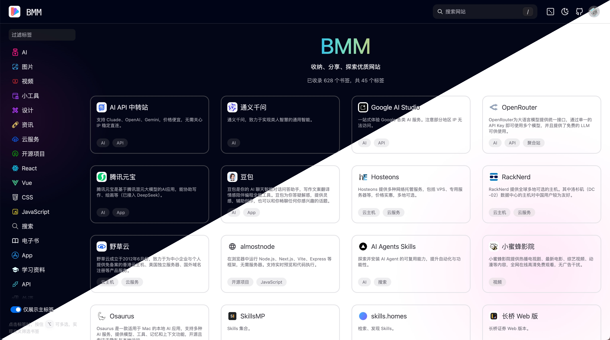
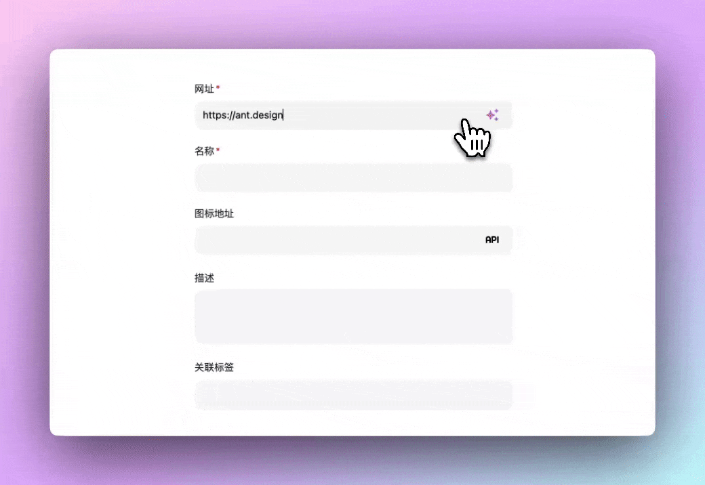
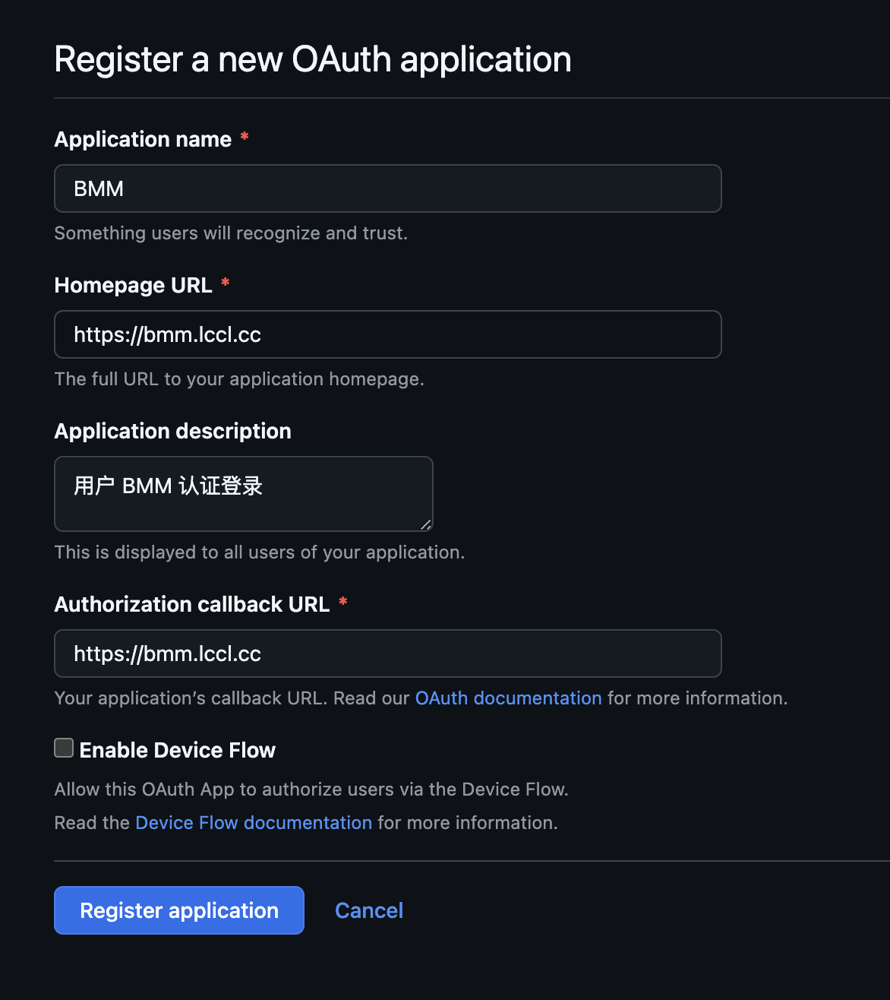
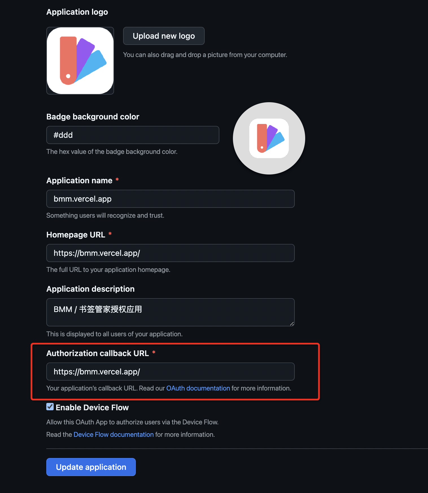
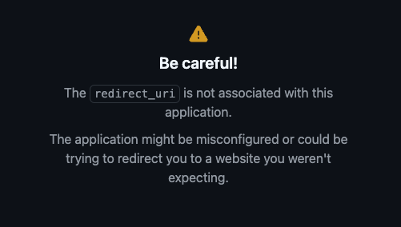

<div align="center">
  
  <h1>BMM</h1>
  <p>收纳、整理、搜索与分享网站书签的开源全栈应用。</p>
  <p>面向个人与团队的书签管理器，支持公开展示、用户空间、后台维护，以及 AI 辅助整理流程。</p>
  <p>
    <a href="https://bmm.lccl.cc/" target="_blank">在线体验</a> ·
    <a href="https://github.com/Y80/bmm" target="_blank">GitHub</a> ·
    <a href="#quick-start">快速开始</a>
  </p>
  <p>
    
    
    
    
    
  </p>
</div>

<!-- README-I18N:START -->

**简体中文** | [English](./README.en.md)

<!-- README-I18N:END -->

<div align="center">
  
  
  
  
</div>

<a id="overview"></a>

## 概览

BMM 是一个用于管理网站书签的开源应用。它把“收藏网页”“按标签整理”“公开展示优质网站”“在后台持续维护数据”放到同一套系统里，并为书签录入提供自动抓取与 AI 辅助能力。

你可以把它当作：

- 个人书签仪表盘
- 团队内的知识导航站
- 对外公开的优质网站目录

<a id="highlights"></a>

## 核心能力

- 公开页、用户空间、管理后台三套使用场景共存，适合从个人使用逐步扩展到公共导航站。
- 支持导入浏览器导出的书签文件，能把目录结构转为标签关联，降低迁移成本。
- 支持标签与书签的多对多关系、拖拽排序、关键词检索与拼音检索。
- 自动抓取网站标题、描述、图标，并补充常见图标路径探测能力。
- 支持 GitHub OAuth 与邮箱密码登录。
- 通过 AI 自动分析网站信息、推荐标签，并为标签生成关联建议与主题色。
- 响应式界面同时覆盖桌面端与移动端，支持亮色与暗色主题。

<a id="roadmap"></a>

## 计划中的功能

- [ ] 多功能卡片，例如天气与资讯
- [ ] 浏览器扩展插件
- [ ] 书签可用性检测
- [ ] 稍后阅读系统

<a id="stack"></a>

## 技术栈

| 类别   | 技术                                                                 |
| ------ | -------------------------------------------------------------------- |
| 框架   | [Next.js 16](https://nextjs.org/) + React 19                         |
| 语言   | [TypeScript](https://www.typescriptlang.org/)                        |
| 样式   | [Tailwind CSS 4](https://tailwindcss.com/)                           |
| UI     | [HeroUI](https://heroui.com/) + [Ant Design](https://ant.design/)    |
| 数据库 | SQLite / PostgreSQL / Turso                                          |
| ORM    | [Drizzle ORM](https://orm.drizzle.team/)                             |
| 认证   | [NextAuth v5 beta](https://authjs.dev/)                              |
| AI     | [Vercel AI SDK](https://sdk.vercel.ai/) + OpenAI-compatible provider |
| 测试   | [Vitest](https://vitest.dev/)                                        |

<a id="quick-start"></a>

## 快速开始

### 环境要求

- [Node.js](https://nodejs.org/) >= 24.0.0
- [pnpm](https://pnpm.io/) >= 10.24.0

> [!TIP]
> 首次本地启动默认使用 SQLite。`pnpm dev`、`pnpm build` 和 `pnpm start` 都会先执行数据库初始化脚本，通常不需要手动建库。

### 本地开发

```bash
git clone https://github.com/Y80/bmm.git
cd bmm
pnpm install
pnpm dev
```

启动后访问 `http://localhost:3000`。

<a id="scripts"></a>

## 常用命令

| 命令              | 说明                                             |
| ----------------- | ------------------------------------------------ |
| `pnpm dev`        | 启动开发环境，并在启动前执行数据库初始化         |
| `pnpm build`      | 生产构建                                         |
| `pnpm start`      | 运行生产构建                                     |
| `pnpm lint`       | 执行 ESLint                                      |
| `pnpm test`       | 运行 Vitest 测试                                 |
| `pnpm db:test`    | 检查数据库是否可连接                             |
| `pnpm db:migrate` | 生成并执行数据库迁移                             |
| `pnpm db:push`    | 直接根据 schema 推送数据库变更，可能导致数据风险 |
| `pnpm studio`     | 打开 Drizzle Studio                              |

<a id="env"></a>

## 环境变量

完整示例可参考 [`.env`](./.env)。

> [!TIP]
> 如果你只想先把项目跑起来，本地开发通常只需要默认 SQLite 配置。AI 供应商在管理员后台配置，不需要环境变量。

| 变量                 | 用途                                       |
| -------------------- | ------------------------------------------ |
| `DB_DRIVER`          | 数据库驱动，支持 `sqlite` 或 `postgresql`  |
| `DB_CONNECTION_URL`  | 数据库连接串                               |
| `DB_AUTH_TOKEN`      | Turso 或 libsql 场景的令牌，可选           |
| `AUTH_URL`           | 当前站点访问地址，OAuth 回调与部署时会用到 |
| `AUTH_SECRET`        | NextAuth 密钥，生产环境建议配置            |
| `AUTH_GITHUB_ID`     | GitHub OAuth Client ID，可选               |
| `AUTH_GITHUB_SECRET` | GitHub OAuth Client Secret，可选           |

<a id="database"></a>

## 数据库

BMM 目前直接支持 SQLite、PostgreSQL 与 Turso。

- 本地默认方案是 SQLite，数据库文件会在首次运行时自动初始化。
- 切换到 PostgreSQL 或 Turso 时，只需要调整 `DB_DRIVER` 与 `DB_CONNECTION_URL`。
- 仓库内提供了 [`docker-compose.yml`](./docker-compose.yml) 作为 PostgreSQL 场景示例。

如果你只想检查数据库状态，可以执行：

```bash
pnpm db:test
pnpm db:migrate
```

<a id="deployment"></a>

## 部署

### Node 部署

```bash
git clone https://github.com/Y80/bmm.git
cd bmm
pnpm install
pnpm build
pnpm start
```

### Docker 部署

使用 Docker Hub 上的 [BMM 官方镜像](https://hub.docker.com/r/lcclcc/bmm/tags) `lcclcc/bmm:latest`。该镜像目前支持 `linux/amd64`，可直接拉取。`latest` 跟随 `main` 更新。需要固定版本时，在镜像地址中使用发布记录对应的完整 Git 提交 SHA 标签。

先创建 `.env.docker.local`，并保留它以便重建容器。首次在本机运行时可用以下命令生成配置：

```bash
(umask 077; set -C; printf 'AUTH_URL=http://localhost:3000\nAUTH_SECRET=%s\n' \
  "$(openssl rand -hex 32)" > .env.docker.local)
```

如果通过域名访问，将 `AUTH_URL` 改为实际访问地址。启用 GitHub 登录时，按[认证配置](#oauth)添加 OAuth Client ID 和 Secret，并设置对应的回调地址。

#### SQLite

```bash
docker pull lcclcc/bmm:latest
docker run -d --name bmm --restart unless-stopped \
  --env-file .env.docker.local \
  -e DB_DRIVER=sqlite \
  -e DB_CONNECTION_URL=file:/app/volume/sqlite.db \
  -v bmm:/app/volume \
  -p 3000:3000 \
  lcclcc/bmm:latest
```

SQLite 数据保存在名为 `bmm` 的数据卷。更新时先备份数据库，拉取镜像后删除旧应用容器，再执行相同的 `docker run` 命令，继续使用原数据卷和环境文件。

#### PostgreSQL

使用仓库中的 [`docker-compose.yml`](./docker-compose.yml)。首次安装时向 `.env.docker.local` 添加 `BMM_POSTGRES_PASSWORD`，可用下列命令生成。已有 PostgreSQL 数据卷时，填写该数据库用户当前的密码。

```bash
printf 'BMM_POSTGRES_PASSWORD=%s\n' "$(openssl rand -hex 24)" >> .env.docker.local
docker compose --env-file .env.docker.local up -d
```

PostgreSQL 数据保存在 `postgres_data` 数据卷。更新前先备份数据并查看版本说明中的迁移要求。只更新应用容器时执行：

```bash
docker compose --env-file .env.docker.local pull app
docker compose --env-file .env.docker.local up -d --no-deps app
```

可在 `.env.docker.local` 设置 `BMM_IMAGE=lcclcc/bmm:<完整提交SHA>` 来固定 Compose 镜像版本。自行配置自动更新工具时，只跟踪 BMM 容器，并在需要手动迁移的版本上安排维护窗口。镜像回退只恢复应用版本，数据库结构需单独处理。

使用自定义构建配置时，也可以通过仓库的 [`Dockerfile`](./Dockerfile) 构建镜像。

### Vercel 部署

1. Fork 本仓库并导入到 Vercel。
2. 在项目的 Environment Variables 中配置数据库与认证参数。
3. 完成部署后，重新核对 `AUTH_URL` 与 GitHub OAuth 回调地址是否一致。

<a id="ai"></a>

## AI 集成

AI 能力用于减少书签录入与整理的手工操作，当前主要覆盖：

- 自动分析网站标题、描述与图标
- 为书签推荐相关标签
- 为标签生成关联建议与主题色

项目通过 Vercel AI SDK 接入 OpenAI-compatible 服务。管理员登录后台后，可在「大模型供应商」页面维护站点级供应商配置，并选择当前启用的供应商。

支持范围包括 OpenAI-compatible 提供商，例如 OpenAI、DeepSeek、Moonshot、GLM 等。若接入非 OpenAI-compatible 服务，可参考 [AI SDK Providers](https://ai-sdk.dev/providers/ai-sdk-providers)。

<a id="oauth"></a>

## GitHub OAuth 配置

> [!IMPORTANT]
> `AUTH_URL`、GitHub OAuth App 的 `Authorization callback URL`、以及用户实际访问 BMM 的地址必须保持一致。

1. 访问 <https://github.com/settings/applications/new> 创建 GitHub OAuth App。
2. 将回调地址设置为 `https://your-domain.com/api/auth/callback/github` 形式。
3. 在环境变量中配置：

```bash
AUTH_GITHUB_ID=your-client-id
AUTH_GITHUB_SECRET=your-client-secret
AUTH_URL=https://your-domain.com
```

如需排查配置错误，可参考下面两张截图：





<a id="faq"></a>

## 常见问题

<details>
<summary><code>AUTH_URL</code> 应该填写什么？</summary>

<br>

它应该等于用户访问 BMM 的实际地址，例如：

- `http://localhost:3000`
- `https://bmm.vercel.app`
- `https://example.com`
- `http://10.1.2.3:3000`

</details>

<details>
<summary>GitHub 登录提示 <code>redirect_uri</code> 错误怎么办？</summary>

<br>

优先检查以下三者是否完全一致：

- GitHub OAuth App 中的 `Authorization callback URL`
- 环境变量 `AUTH_URL`
- 用户实际访问 BMM 的地址

问题示例截图：



</details>

<details>
<summary>修改端口或改成通过 IP 访问后，登录回调不正确怎么办？</summary>

<br>

只要访问地址发生变化，就要同步修改 `AUTH_URL` 和 GitHub OAuth App 中的回调地址。

</details>

<details>
<summary>支持更多数据库吗？</summary>

<br>

当前仓库直接适配的是 SQLite / PostgreSQL / Turso。由于使用了 Drizzle ORM，继续扩展其他数据库的成本相对可控，但需要补充对应 schema 与驱动实现。

</details>
